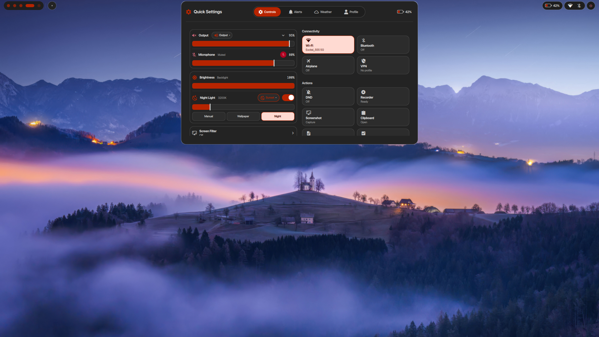
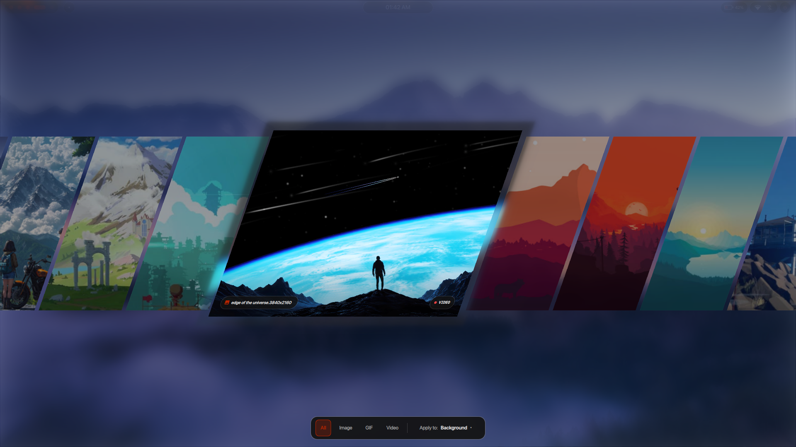
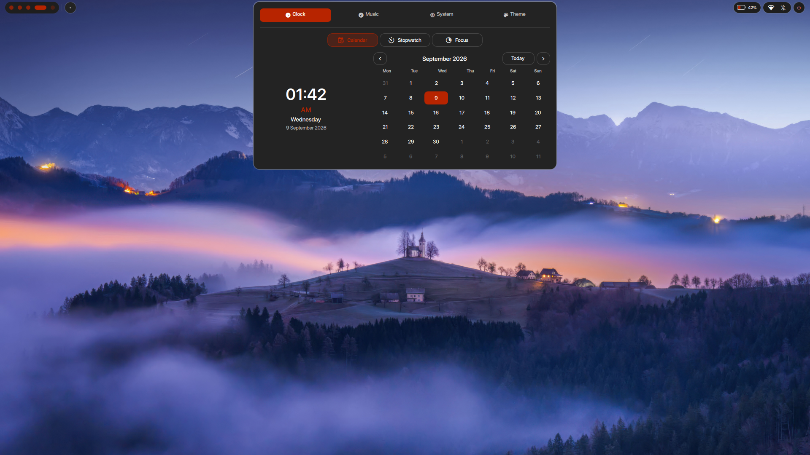
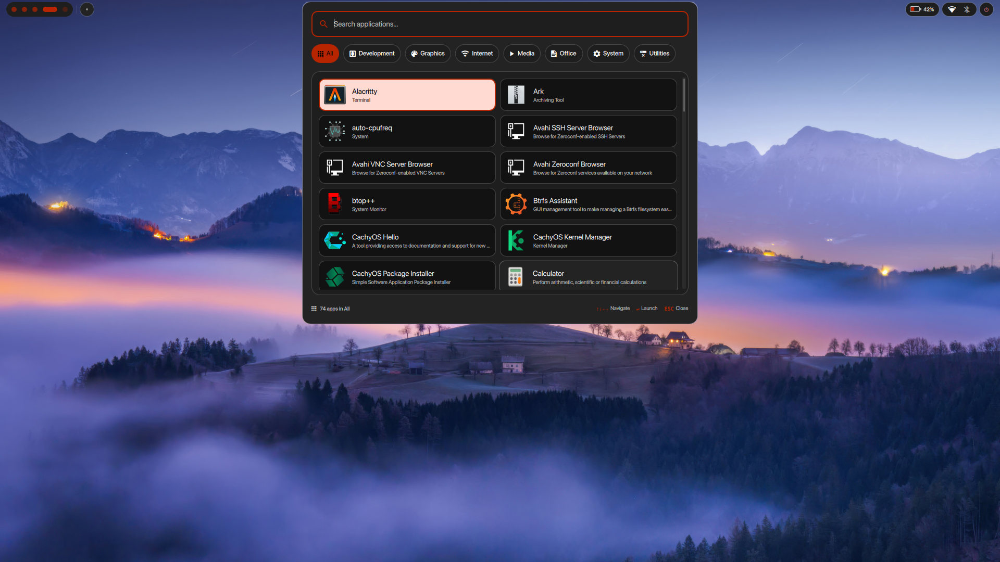
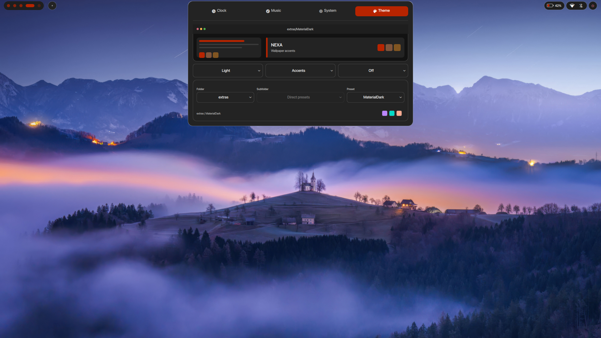
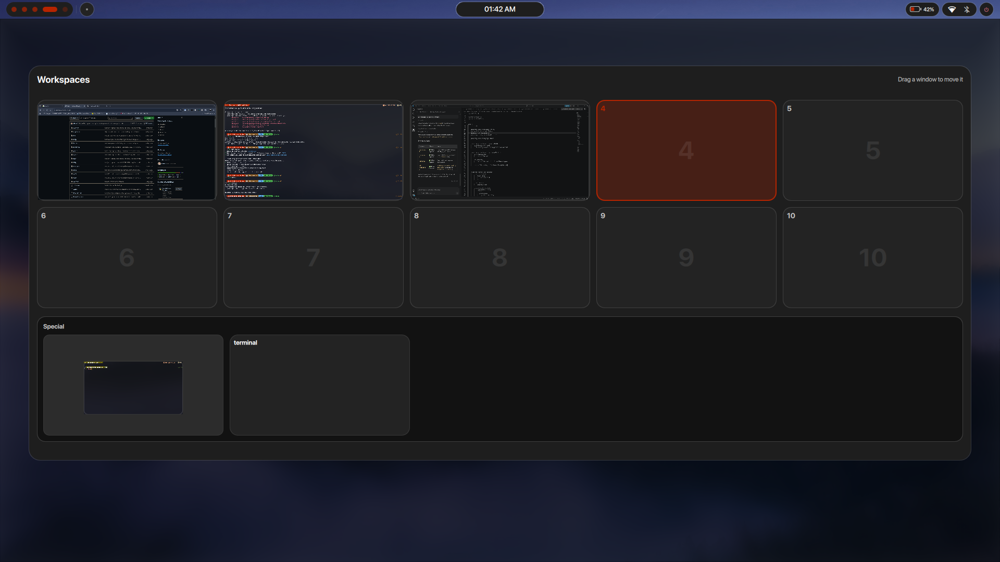

# NEXA Desktop

A sleek, fluid, and modern desktop experience for Linux built on top of **Hyprland** and **Quickshell**, powered by a high-speed **Rust backend** (`nexad`).

Designed to feel as polished and reactive as a flagship mobile OS, while giving you the full power and tiling efficiency of Linux.

---

## 📸 Preview

<div align="center">

### Dynamic Island & Control Center
*An interactive notch with quick settings, volume mixer, calendar, and system status.*



<br/><br/>

| **3D Wallpaper Carousel** | **Dynamic Island Clock & Calendar** |
| :---: | :---: |
| <br/>*3D coverflow carousel supporting Images, GIFs, and Video wallpapers* | <br/>*Expanded calendar, stopwatch, and focus timer* |

<br/>

| **Spotlight App Search** | **Dynamic Theme Engine & Liquid Glass** |
| :---: | :---: |
| <br/>*Instant app search with category filters* | <br/>*Automatic color palettes from your wallpaper + iOS-style frosted glass mode* |

<br/>

### Visual Workspace Manager
*Overview of all workspaces with live window previews.*



</div>

---

## ⚡ Quick Start: Easy Installation

NEXA comes with an automated one-step installer for **Arch Linux** and **CachyOS**.

### 🚀 1. Install NEXA

Open a terminal and run:

```bash
git clone https://github.com/shnx-07/nexa.git dotfiles
cd dotfiles
chmod +x install.sh uninstall.sh
./install.sh
```

**What the installer does for you:**
- Automatically downloads and installs all needed fonts, icons, and tools.
- Creates a safe, timestamped backup of your current configurations.
- Sets up all themes, wallpapers, and desktop components.
- Compiles the fast Rust helper backend (`nexad`).

---

### 🔄 2. Uninstall / Restore

If you ever want to return to your original desktop setup, NEXA can be cleanly uninstalled:

```bash
cd dotfiles
./uninstall.sh
```

Your previous configuration will be automatically restored from your backup.

---

## ✨ Features You'll Love

### 🏝️ Dynamic Island & Control Center
- **Interactive Notch:** Click or hover over the top bar notch to reveal the media player, clock, calendar, weather, or notifications.
- **Quick Settings (`Super + N`):** Easily adjust brightness, volume, Wi-Fi, Bluetooth, night light, and power options from a clean tabbed panel.
- **On-Screen Displays:** Clean, animated indicator capsules appear in the notch when you adjust volume or screen brightness.

### 🖥️ Smart Display Manager (`Super + P`)
- **Effortless Multi-Monitor:** Connect an external monitor or TV and press `Super + P` to switch modes:
  - **PC screen only:** Use only your laptop screen.
  - **Duplicate:** Mirror your screen onto the second display.
  - **Extend:** Expand your desktop across multiple screens (with direction controls: Right, Left, Above, Below).
  - **Second screen only:** Turn off the laptop display and work exclusively on your external monitor.
- **Plug & Play Fallback:** Unplugging your cable automatically and safely restores your windows to your laptop display without flickering or crashes, even on the lock screen.
- **Clamshell Mode:** Close your laptop lid while plugged into an external display to keep working uninterrupted.

### 📁 Dynamic Island Shelf (File Stash Tray)
- **Drag & Drop Anywhere:** Drag any file, image, or document from your browser, file manager, or chat and drop it onto the Dynamic Island notch.
- **Temporary Stash:** Your files stay neatly stored in a deck of cards at the top of your screen until you need them. Drag them out into any app, email, or folder whenever you're ready.

### 🎨 Intelligent Colors & Liquid Glass
- **Wallpaper Color Matching:** Whenever you set a new wallpaper, NEXA extracts matching color tones and updates your entire system (panels, windows, terminals, and apps) in real time.
- **iOS Liquid Glass Mode:** Toggle between clean solid surfaces and translucent frosted liquid glass with realistic background blur and lighting.

### 🖼️ 3D Wallpaper Carousel (`Super + W`)
- **Visual Coverflow:** Browse your wallpapers in an interactive 3D carousel.
- **Video & GIF Support:** Set animated live wallpapers (MP4/WebM videos or GIFs) with seamless playback.
- **Automatic Slideshow:** Have your wallpaper automatically change every 5m, 15m, 30m, 1h, or 2h with smooth transitions.

### 🔍 Spotlight Search & App Launcher (`Super + Space`)
- **Instant Search:** Press `Super + Space` to search through apps, settings, and files instantly.
- **Full App Drawer (`Super + A`):** Categorized view of all your installed software (Development, Media, Office, Utilities).

### 🔒 Elegant Lock Screen & Custom Avatars
- **Sleek Login Screen:** Ambient blurred background with an animated glowing halo ring around your profile avatar.
- **Change Avatar Easily (`nexa-avatar`):**
  ```bash
  # Pick from included artwork presets
  nexa-avatar set astro_space
  nexa-avatar set cyber_neon

  # Or use any personal photo from your computer
  nexa-avatar set ~/Pictures/my_photo.png
  ```

### 🎵 Music Player Experience
- **Spinning Vinyl:** When music is playing, a realistic vinyl disc slides out from behind the album artwork and spins in real time.
- **Built-in Controls:** Seek bar, volume slider, play/pause, and an animated audio visualizer.

### 🔋 Battery Smart
- **Power Saver on Battery:** Automatically reduces heavy blur and visual effects when you unplug from power, extending your laptop's battery life.

---

## ⌨️ Essential Keyboard Shortcuts

| Shortcut | What It Does |
| :--- | :--- |
| `Super + Space` | Spotlight Search (Apps & Files) |
| `Super + P` | Display & Projector Switcher (Extend, Mirror, External Only) |
| `Super + N` | Open Control Center & Quick Settings |
| `Super + A` | Open All Applications Drawer |
| `Super + W` | Open 3D Wallpaper Picker |
| `Super + V` | Open Clipboard History |
| `Super + L` | Lock Screen |
| `Super + E` | Open File Manager |
| `Super + Return` | Open Terminal |
| `Super + Shift + Return` | Toggle Dropdown Scratchpad Terminal |
| `Super + Q` | Close Current Window |
| `Super + F` | Fullscreen Window |
| `Super + T` | Float Window |
| `Super + Tab` | Show Workspace Overview |
| `Super + Shift + S` | Snipping Tool (Select area to screenshot) |
| `Super + X` | Full Screenshot |
| `F1` / `F2` / `F3` | Mute / Volume Down / Volume Up |
| `F5` / `F6` | Brightness Down / Brightness Up |

---

## 📂 File Locations

For users who like to customize their files:

```text
~/.config/nexa/
├── config/              # User settings (theme, wallpaper, monitors)
├── quickshell/          # User interface components
├── rust/                # High-speed backend helper (nexad)
└── scripts/             # Useful system automation scripts
```

---

## 📜 License

Distributed under the MIT License.
