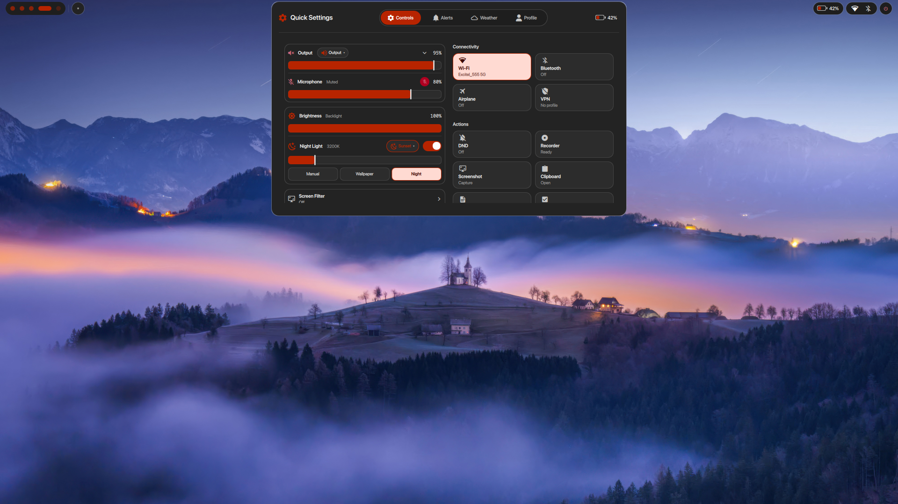
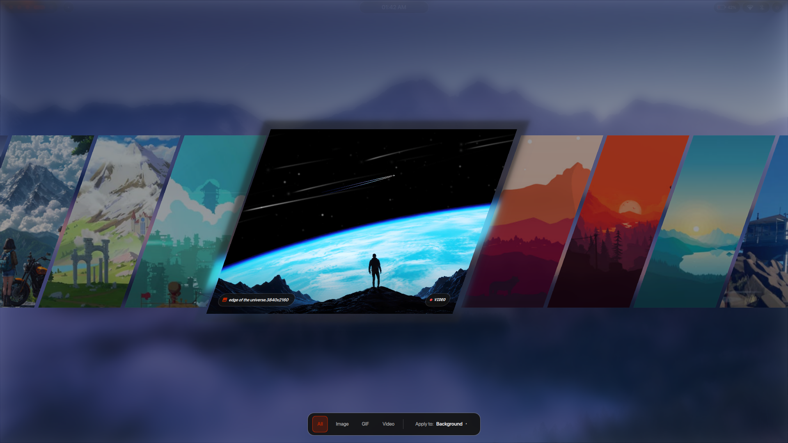
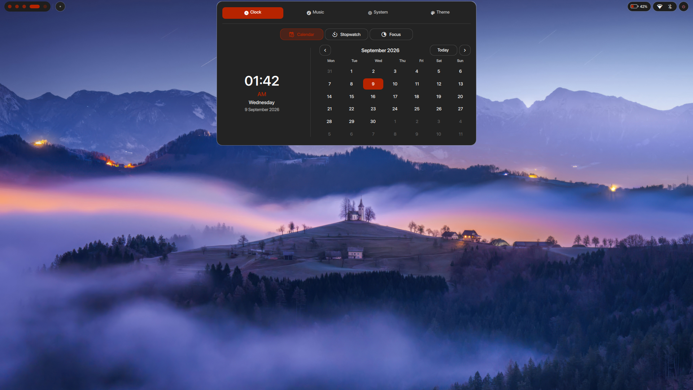
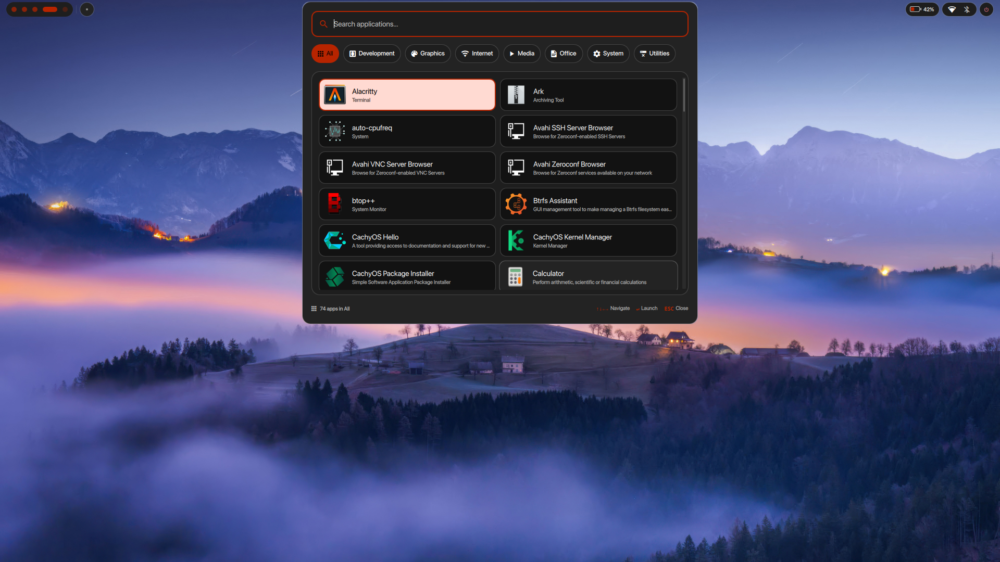
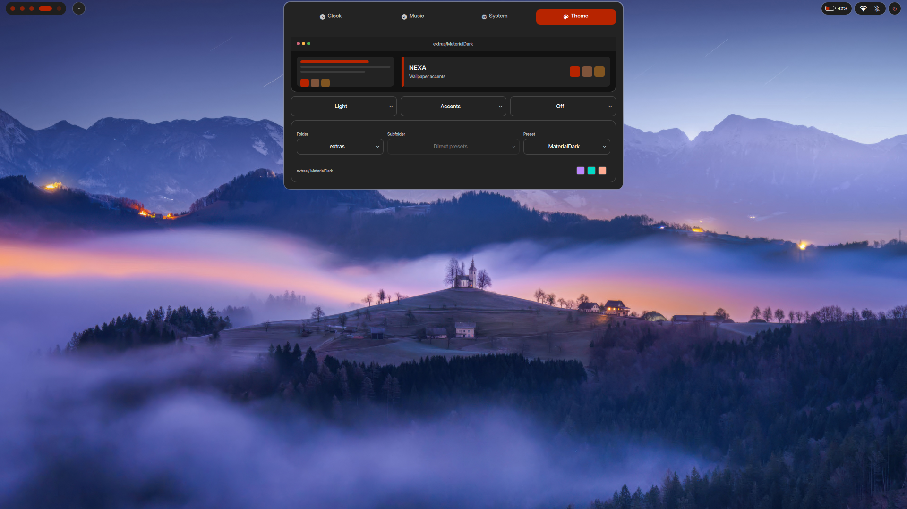
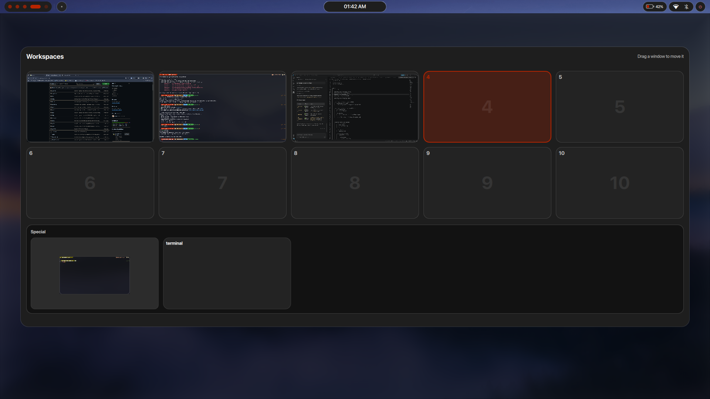

# NEXA Desktop

A sleek, fluid, and modern desktop experience for Linux built on top of **Hyprland** and **Quickshell**, powered by a high-speed **Rust backend** (`nexad`).

Designed to feel as polished, tactile, and reactive as a flagship mobile OS, while giving you the full power, tiling efficiency, and limitless customization of Linux.

---

## 📸 Preview

<div align="center">

### Dynamic Island & Control Center
*An interactive notch with quick settings, per-app audio mixer, calendar, weather, and system status.*



<br/><br/>

| **3D Wallpaper Carousel** | **Dynamic Island Clock & Calendar** |
| :---: | :---: |
| <br/>*3D coverflow carousel supporting Images, GIFs, and Video wallpapers with automated slideshow* | <br/>*Expanded calendar, stopwatch, focus timer, and media controls* |

<br/>

| **Spotlight App Search** | **Dynamic Theme Engine & Shaders** |
| :---: | :---: |
| <br/>*Sub-millisecond app search with category filters* | <br/>*Material You color extraction, screen filters, and GPU optical refraction shaders* |

<br/>

### Visual Workspace Manager
*Overview of all workspaces with live Wayland window previews and candidate drag-and-drop targets.*



</div>

---

## ⚡ Quick Start: Automated Installation

NEXA comes with an automated one-step installer and uninstaller for **Arch Linux** and **CachyOS**.

### 🚀 1. Install NEXA

Open a terminal and run:

```bash
git clone https://github.com/shnx-07/nexa.git dotfiles
cd dotfiles
chmod +x install.sh uninstall.sh
./install.sh
```

**What the installer does for you:**
- Checks and bootstraps `yay` if no AUR helper is present.
- Automatically downloads and installs all required fonts, icons, audio, and Wayland tools.
- Creates a safe, timestamped backup of your existing configs (`~/.config/nexa_backups/`).
- Deploys Hyprland, Quickshell, Kitty, Alacritty, WezTerm, Matugen, GTK, Qt/Qt6ct, KDE Globals, and Starship.
- Compiles the fast Rust helper backend (`nexad`).
- Automatically updates `hyprpm` and enables `hyprglass` and `dynamic-cursors`.
- Sets up wallpaper cache and runtime directories.

---

### 🔄 2. Uninstall / Restore

If you ever want to return to your original desktop setup, NEXA can be cleanly uninstalled:

```bash
cd dotfiles
./uninstall.sh
```

Your previous configuration will be automatically restored from your backup.

---

## 🛠️ Unified Nexa Management CLI (`nexa.sh`)

NEXA provides a central management script located at `~/.config/nexa/scripts/nexa.sh` (or symlinked in your path as `nexa`).

```text
======================================================
                  NEXA DESKTOP MANAGER                
======================================================
  1) Start Nexa
  2) Stop Nexa
  3) Restart Nexa
  4) Nexa Daemon (nexad)
  5) Shapes & Window Aesthetics
  6) Recompile Nexad
  7) Theme Sync (Propagate Nexa to Chrome, GTK, QT, Terminals)
  8) Check Status
  9) Exit
======================================================
```

You can also invoke actions directly from the command line:
```bash
# Restart the shell and backend daemons cleanly
nexa restart

# Sync Material You colors to Chrome, GTK, Qt, and terminals
nexa theme-sync

# Check status of all Nexa processes
nexa status
```

---

## ✨ Features You'll Love

### 🏝️ Dynamic Island & Control Center
- **Interactive Notch:** Click or hover over the top bar notch to reveal the media player, clock, calendar, weather, or notifications.
- **Quick Settings (`Super + N`):** Easily adjust brightness, volume, Wi-Fi, Bluetooth, night light, and power profiles from a clean tabbed panel.
- **On-Screen Displays (OSD):** Zero-latency hardware feedback capsules in the notch when adjusting volume, mic mute, brightness, or airplane mode.

### 📁 Dynamic Island Shelf (Wayland Stash Tray)
- **Drag & Drop Anywhere:** Drag files, images, or documents from your browser or file manager and drop them onto the Dynamic Island notch (`580px × 155px`).
- **Card Deck:** Files stay neatly stored in a deck of cards at the top of your screen until you need them. Drag them out into any app, email, or chat whenever you're ready.
- **Batch Clipboard Actions:** Copy individual paths or all stashed paths with animated feedback.

### 🎨 Material You Theming & System Theme Settings
- **Wallpaper Color Matching:** Applying any wallpaper automatically extracts harmonic Material You color tokens via Matugen.
- **Desktop Theme Sync (Option 7):** Instantly propagates the active palette across:
  - **Hyprland:** Window borders, active shadows, and accents (`colors.lua`).
  - **Browsers:** Google Chrome & Chromium tab strip, toolbar, and accent colors.
  - **GTK 3 & GTK 4:** Global CSS variables (`gtk.css`).
  - **Qt & KDE:** Kvantum, Qt5ct, Qt6ct, and `kdeglobals` (`Nexa.colors`).
  - **Terminals:** Alacritty, Kitty, WezTerm, and Btop monitor.
- **System Themes Studio:** Dedicated settings hub with sub-tabs for:
  - **Presets:** 85+ curated Material You color schemes.
  - **Wallpaper & Material:** Live palette preview with tone extraction.
  - **Windows & Effects:** Blur strength, corner rounding, shadows, and isolated island geometry.
  - **Filters:** Fullscreen post-processing screen filters (Chroma, Monochrome, HDR Boost, High Contrast, Invert, Sepia, Paper Mode, Off).
  - **Shaders & Glass:** Real-time GPU screen shaders (Aurora, Liquid Glass, Noir Halftone, Rain Glass, Starfall).

### 🔊 Sound & Audio Event Engine
- **Sleek Sound Settings:** High-density grouped container card with aligned sliders, percentage indicators, format badges, and live preview buttons.
- **Categorized Event Controls:** Easily filter and toggle sounds by category:
  - `⚡ Power & Battery` (Charger connect/disconnect, low battery warning)
  - `🔒 Security` (Lock screen trigger, unlock success/failure)
  - `🔊 Alerts & Actions` (Screenshot capture, volume change, shelf drop, popup notifications)

### 🖥️ Smart Display Manager (`Super + P`)
- **Effortless Multi-Monitor:** Connect an external monitor or TV and press `Super + P` to switch modes:
  - **PC screen only:** Use only your laptop screen.
  - **Duplicate:** Mirror your screen onto the second display.
  - **Extend:** Expand your desktop across multiple screens with directional controls.
  - **Second screen only:** Turn off the laptop display and work exclusively on your external monitor.
- **Plug & Play Fallback:** Hotplug events automatically and cleanly restart the shell and restore your wallpaper without flickering or crashes.
- **Clamshell Mode:** Close your laptop lid while plugged into an external display to keep working uninterrupted.

### 🖼️ 3D Wallpaper Carousel (`Super + W`)
- **Visual Coverflow:** Browse your wallpapers in an interactive 3D carousel with perspective rotation and depth scaling.
- **Video & GIF Support:** Set animated live wallpapers (MP4/WebM videos or GIFs) with hardware-accelerated playback.
- **Automatic Slideshow:** Have your wallpaper automatically cycle every 5m, 15m, 30m, 1h, or 2h with smooth transitions (`fade`, `wipe`, `slide`, `random`).

### 🔍 Spotlight Search & App Launcher (`Super + Space`)
- **Instant Search:** Fuzzy app and file search powered by the `nexad` Rust backend.
- **Full App Drawer (`Super + A`):** High-density categorized view of all installed software (Development, Media, Office, Utilities).

### 🔒 Cyber-Glass Lock Screen & Custom Avatars
- **Sleek Login Screen:** Ambient blurred background with an animated glowing halo ring around your profile avatar that pulses with theme accents when typing passwords.
- **Custom Avatar CLI (`nexa-avatar`):**
  ```bash
  # Pick from included artwork presets
  nexa-avatar set astro_space
  nexa-avatar set cyber_neon
  nexa-avatar set mecha_cat

  # Or use any personal photo from your computer
  nexa-avatar set ~/Pictures/my_photo.png
  ```

### 🎵 Cyber-Luminous Music Deck
- **Spinning Vinyl Disc:** A realistic vinyl record with micro-grooves physically slides out from behind the album artwork and spins in real time during playback.
- **Built-in Controls:** Seek bar with monospace timestamps, hero play/pause button, shuffle/loop toggles, and an integrated audio visualizer spectrum.

### ⚡ Battery & Performance Optimized
- **Power Saver on Battery:** Automatically switches to power-saver and reduces heavy multi-pass blur and expensive shaders when unplugged, slashing battery drain by up to 80%.
- **0% Idle Polling:** System monitors and visualizers sleep when closed, eliminating unnecessary background CPU load.

---

## ⌨️ Essential Keyboard Shortcuts

| Shortcut | What It Does |
| :--- | :--- |
| `Super + Space` | Spotlight Search (Apps & Files) |
| `Super + Shift + Space` | Dynamic Island Command Palette |
| `Super + P` | Display & Projector Switcher (Extend, Mirror, External Only) |
| `Super + N` | Open Control Center & Quick Settings |
| `Super + A` | Open All Applications Drawer |
| `Super + W` | Open 3D Wallpaper Picker |
| `Super + V` | Open Clipboard History (`cliphist`) |
| `Super + L` | Lock Screen |
| `Super + E` | Open File Manager (`nemo`) |
| `Super + Return` | Open Tiled Terminal (`kitty`) |
| `Super + Shift + T` | Toggle Floating for Focused Terminal |
| `Super + Shift + Return` | Toggle Dropdown Scratchpad Terminal |
| `Super + Q` | Close Current Window (with clean process termination) |
| `Super + Shift + Q` | Force-Kill Window (`kill -9`) |
| `Super + F` | Fullscreen Window |
| `Super + T` | Float Window |
| `Super + Tab` | Show Workspace Overview |
| `Super + Shift + S` | Snipping Tool (Select area to screenshot) |
| `Super + X` | Instant Full Screenshot |
| `F1` / `F2` / `F3` | Mute / Volume Down / Volume Up |
| `F4` | Microphone Mute Toggle |
| `F5` / `F6` | Brightness Down / Brightness Up |
| `F8` | Airplane Mode Toggle |

---

## 📂 Project Directory Structure

```text
~/.config/nexa/
├── config/              # User settings (theme, wallpaper, monitors, sound, island)
│   ├── decorations/     # Window and rail decorations configuration
│   └── sound.json       # Sound event triggers & volume levels
├── quickshell/          # QML User Interface
│   ├── bar/             # Top bar and workspace pills
│   ├── decorations/     # Constellation rail and window decorations
│   ├── island/          # Dynamic Island, Shelf, OSD, and Control Center
│   ├── modules/         # AppLauncher, Workspace, LockScreen, Media, Settings
│   ├── services/        # Audio visualizer, theming, and hardware monitors
│   ├── shaders/         # GPU screen shaders (theme/ and lockScreenShaders/)
│   └── theme/           # Material color tokens and reusable UI components
├── rust/                # High-speed backend helper (nexad)
│   ├── src/decorations/ # Constellation rail state and geometry
│   ├── src/hardware/    # Network, power, and system monitoring
│   ├── src/hyprland/    # IPC, binds, idle, and display monitors
│   └── src/wallpaper/   # Transitions, apply engine, and slideshow daemon
└── scripts/             # Management scripts (nexa.sh, nexa-avatar.sh, nexa_shader.sh)
```

---

## 📜 License

Distributed under the MIT License.
